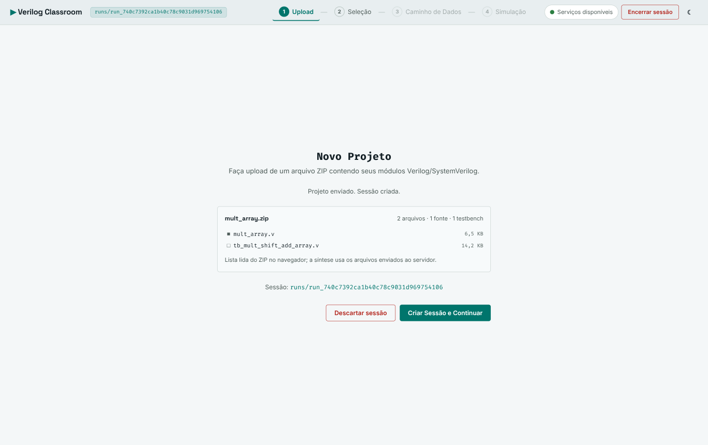
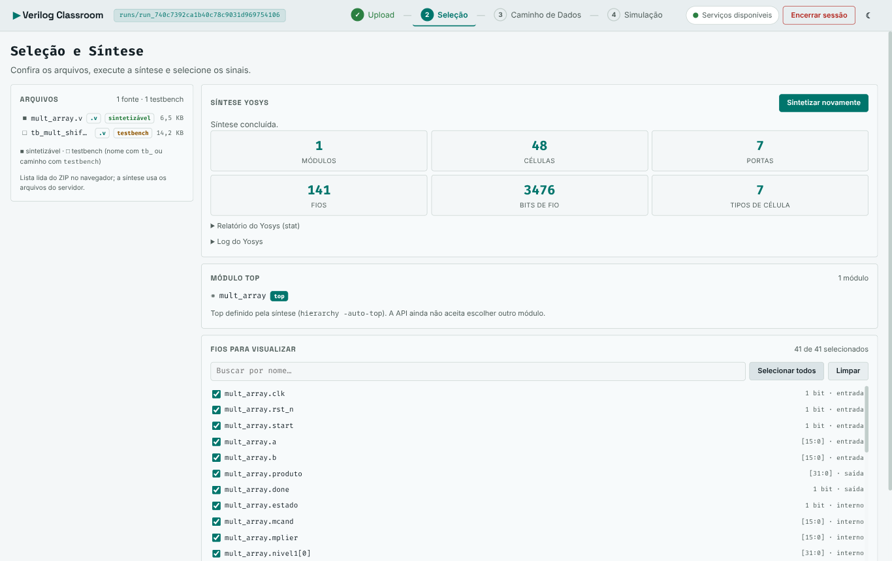
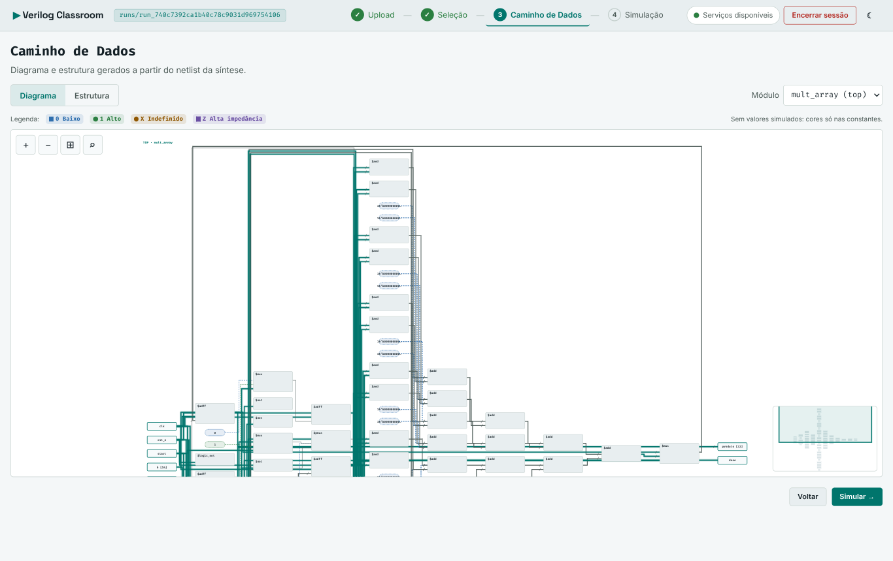
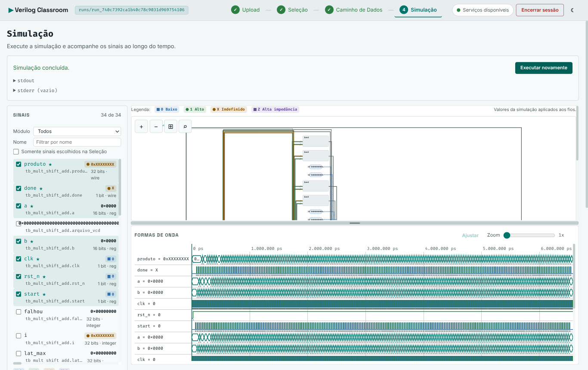

# Proposta
Atualmente, ferramentas de simulação de hardware utilizam as ondas geradas pelo processador para verificar a execução correta do código. Além de ser trabalhosa, essa metodologia é chata, propensa a erros e ameaçadora para estudantes. Nós propomos uma forma de simular o hardware de forma mais intuitiva e de fácil acesso, usando interfaces web.
# Para quem é essa ferramenta
- Professores que desejam uma porta de entrada mais amigável para o estudo de hardware.
- Estudantes que querem ver como seu código em verilog se comporta de verdade.
- Profissionais que querem testar a simulação do seu hardware descrito em verilg por interface web

# O que o projeto faz
O Verilog Classroom recebe um projeto Verilog/SystemVerilog em `.zip`, sintetiza o hardware com o
Yosys, simula o testbench com o Icarus Verilog e mostra o resultado no navegador. O fluxo tem quatro
etapas, e cada uma só libera a seguinte depois de concluída.

## 1. Upload
O aluno envia um `.zip` com os módulos e o testbench. O backend extrai os arquivos numa pasta
temporária do servidor (`verilog_code/runs/run_<uuid>`) e devolve o identificador da sessão. A tela
lista os arquivos do ZIP e separa fontes de testbench.



## 2. Seleção e síntese
O Yosys sintetiza os arquivos fonte e define o módulo top automaticamente (`hierarchy -auto-top`).
A tela mostra a contagem de módulos, células, portas e fios, o relatório `stat` e o log do Yosys.
Abaixo vem a lista de fios do netlist, onde o aluno escolhe quais quer acompanhar na simulação.



## 3. Caminho de dados
O netlist da síntese vira um diagrama do circuito, com zoom, minimapa e painel de propriedades de
cada célula. A aba "Estrutura" lista as portas, células e fios de cada módulo.



## 4. Simulação
O Icarus compila e executa o testbench. O backend lê o VCD gerado e envia os sinais ao frontend,
que aplica os valores no diagrama e desenha as formas de onda. As cores seguem a legenda: azul para
0, verde para 1, laranja para X (indefinido) e roxo para Z (alta impedância). O stdout e o stderr
da simulação ficam disponíveis na própria tela.



# Como rodar

## Pré-requisitos
- Docker com o plugin Compose (`docker compose`).
- Git.

Para rodar backend ou frontend fora do Docker também é preciso Python 3.13 com
[`uv`](https://docs.astral.sh/uv/) e Node.js 20.

## Com Docker (recomendado)
Na raiz do repositório:

```bash
git clone git@github.com:SoaresDavidson/Verilog-simulator.git
cd Verilog-simulator
docker compose up --build
```

O comando constrói as imagens do Yosys e do Icarus e sobe o backend e o frontend:

- Interface: <http://localhost:5173>
- API: <http://localhost:8000> (documentação em <http://localhost:8000/docs>)

Rode o `docker compose` a partir da raiz. O backend cria um container novo do Yosys ou do Icarus
a cada execução e monta nele as pastas `verilog_code/` e `scripts/` do host, e o caminho dessas
pastas vem de `${PWD}`. Se precisar rodar de outro diretório, defina `HOST_VERILOG_ROOT` e
`HOST_SCRIPTS_DIR` num `.env` na raiz.

O backend acessa o Docker do host pelo socket `/var/run/docker.sock`. As imagens de execução usam
UID/GID 1000 por padrão; se o seu usuário tiver outro UID, defina `EXECUTION_UID` e `EXECUTION_GID`
no `.env` da raiz.

Para parar:

```bash
docker compose down
```

## Sem Docker para backend e frontend
O Yosys e o Icarus continuam rodando em containers, então as imagens precisam existir:

```bash
docker compose build yosys icarus
```

Backend (detalhes em [backend/README.md](backend/README.md)):

```bash
cd backend
cp .env.example .env
uv sync
uv run uvicorn main:app --reload
```

Frontend (detalhes em [frontend/README.md](frontend/README.md)):

```bash
cd frontend
npm install
npm run dev
```

O frontend usa `VITE_API_URL` para achar a API (padrão `http://localhost:8000/api/v1`, ver
`frontend/.env.example`). As variáveis do backend estão em
[backend/.env.example](backend/.env.example).

## Testes

```bash
cd backend && uv run pytest
cd frontend && npm test
```

## Formato do projeto enviado
- Um `.zip` com os arquivos `.v` ou `.sv`.
- O testbench precisa ter `tb_` no nome do arquivo ou `testbench` no caminho. A síntese ignora
  esses arquivos; sem a marcação, o Yosys tenta sintetizar o testbench.
- O testbench precisa gerar um VCD com `$dumpfile` e `$dumpvars`; sem ele não há formas de onda.
- Há exemplos de projetos em `backend/tests/fixtures/projetos/multiplicadores/`.

# API: sessão e autenticação
- O upload (`POST /api/v1/verilog/upload-projeto-zip`) devolve `project_id` e `session_token`.
- `mapear-processador`, `simular-execucao` e `DELETE /projeto/{project_id}` exigem o header
  `X-Session-Token` com o token recebido no upload (`401` sem token, `403` token de outra sessão).
- `POST /api/v1/verilog/limpar` exige `X-Admin-Token` igual à variável `ADMIN_TOKEN` do backend;
  sem `ADMIN_TOKEN` configurado a rota fica desabilitada.
- Detalhes e variáveis em [`backend/README.md`](backend/README.md) e `backend/.env.example`.

# Retenção
Os projetos enviados são temporários: runs sem uso por mais de `RUN_TTL_HOURS` (padrão 6 h) são
apagados automaticamente, e um teto opcional de espaço (`RUNS_MAX_TOTAL_BYTES`) remove os mais
antigos primeiro. Veja [`backend/README.md`](backend/README.md#retenção-dos-projetos-enviados).
